# EventHub

EventHub is a Django REST API for a simplified event ticketing platform. Clients can browse events, reserve seats, and cancel reservations. Seat counts stay consistent when two bookings try to take the last seats at the same time.

## Requirements

- Python 3.10 or newer (developed with Python 3.12)
- Django 5.2
- Django REST Framework 3.16

## How to run

From the project root:

```bash
python3 -m venv .venv
source .venv/bin/activate
pip install -r requirements.txt
python manage.py migrate
python manage.py runserver
```

The API is served at `http://127.0.0.1:8000/api/`.

Every request is written to the terminal by `RequestLoggingMiddleware`, for example:

```text
POST /api/reservations/ - 201 - 0.01s
```

Run the test suite with:

```bash
python manage.py test
```

## Endpoints

### Events

| Method | URL | What it does |
| --- | --- | --- |
| `GET` | `/api/events/` | List events. Optional filters: `status` (exact) and `venue` (case-insensitive contains). |
| `POST` | `/api/events/` | Create an event. `available_seats` cannot be greater than `total_seats`. |
| `GET` | `/api/events/{id}/` | Retrieve one event, including `reservations_count` (confirmed reservations only). |
| `PUT` / `PATCH` | `/api/events/{id}/` | Update an event. |
| `DELETE` | `/api/events/{id}/` | Delete an event and its reservations. |

Create event:

```bash
curl -X POST http://127.0.0.1:8000/api/events/ \
  -H 'Content-Type: application/json' \
  -d '{
    "title": "PyCon India 2025",
    "venue": "NIMHANS Convention Centre, Bangalore",
    "date": "2025-09-20",
    "total_seats": 500,
    "available_seats": 500,
    "status": "upcoming"
  }'
```

### Reservations

| Method | URL | What it does |
| --- | --- | --- |
| `GET` | `/api/reservations/` | List reservations. Optional filter: `event_id`. |
| `POST` | `/api/reservations/` | Reserve seats. Deducts `seats_reserved` from the event. Returns `201` when the booking is confirmed, or `400` when the event is not open or not enough seats are left. |
| `GET` | `/api/reservations/{id}/` | Retrieve one reservation. |
| `PUT` / `PATCH` | `/api/reservations/{id}/` | Update attendee details or seat count. Confirmed seat changes adjust `available_seats`. |
| `DELETE` | `/api/reservations/{id}/` | Delete a reservation. Confirmed seats are returned to the event. |
| `POST` | `/api/reservations/{id}/cancel/` | Cancel a reservation and return its seats. A second cancel returns `400` with `{"error": "Already cancelled."}`. |

Reserve seats:

```bash
curl -X POST http://127.0.0.1:8000/api/reservations/ \
  -H 'Content-Type: application/json' \
  -d '{
    "event": 1,
    "attendee_name": "Priya Sharma",
    "attendee_email": "priya@example.com",
    "seats_reserved": 2
  }'
```

Cancel:

```bash
curl -X POST http://127.0.0.1:8000/api/reservations/1/cancel/
```

## API test results

These screenshots are from the running API at `http://127.0.0.1:8000/api/`. The database has several events (upcoming, ongoing, and completed, in Bangalore, Pune, Delhi, and Hubbali) so the filters return more than one row.

### Create an event — 201 Created

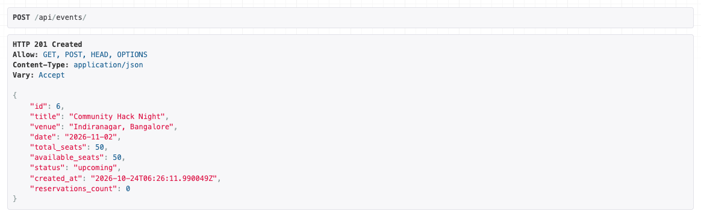

### List events

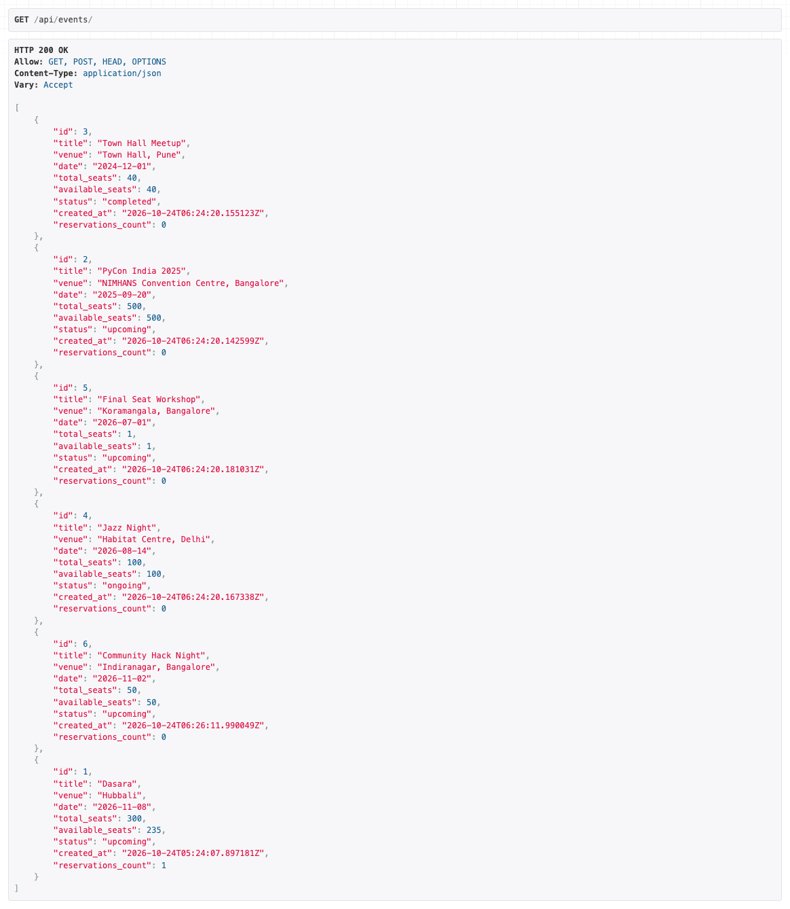

### Filter events by status

`GET /api/events/?status=upcoming`

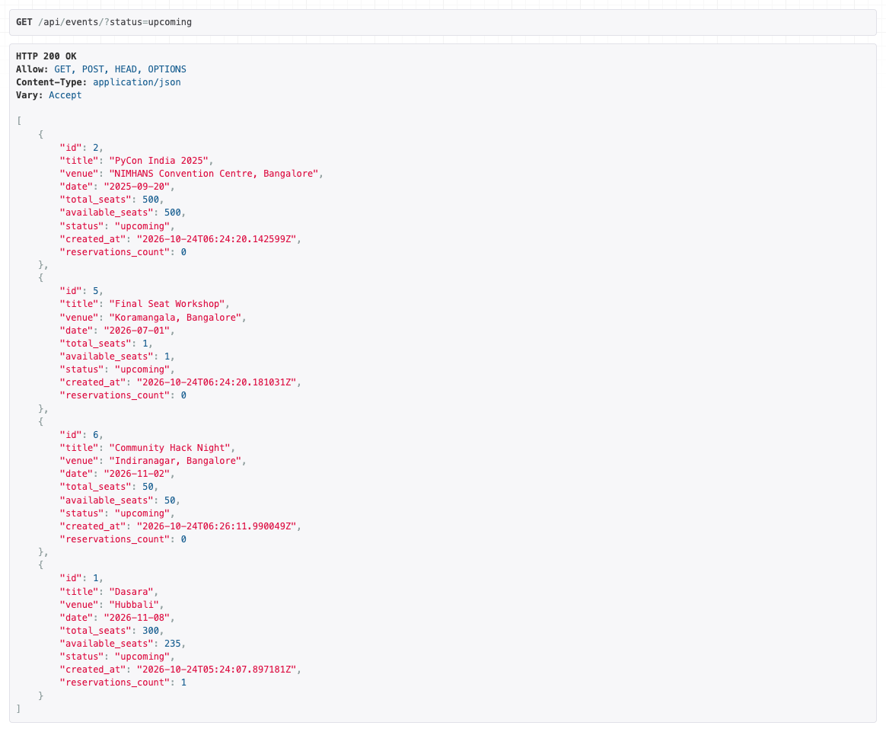

### Filter events by venue

`GET /api/events/?venue=bangalore`

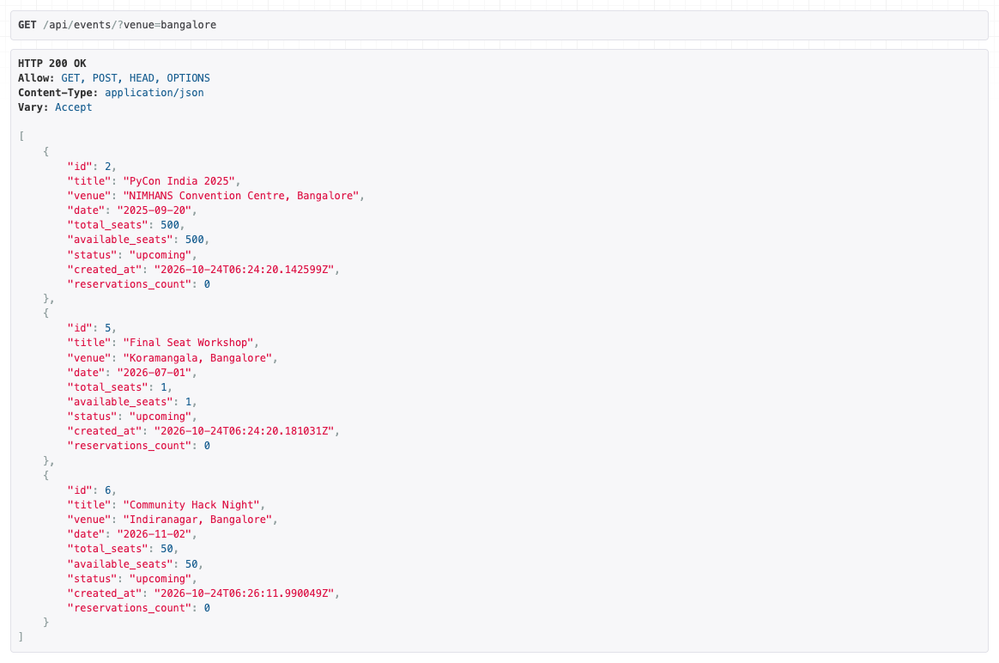

### Reserve seats — 201 Created

Priya Sharma reserves 2 seats for PyCon India 2025.

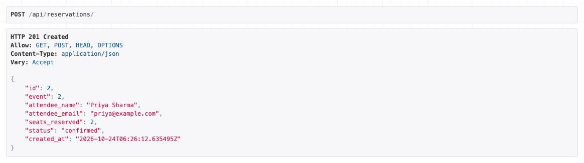

### Seats deducted from the event

Available seats go from 500 to 498, and `reservations_count` is 1.


### Overbooking — 400 Bad Request

Final Seat Workshop has 1 seat. Reserving 2 seats is rejected.

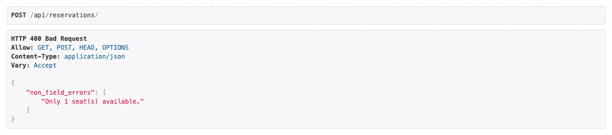

The failed request does not change the event.

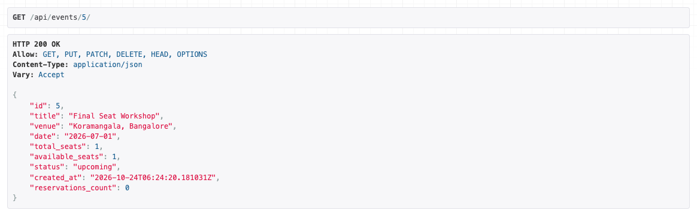

### Cancel a reservation

`POST /api/reservations/2/cancel/`

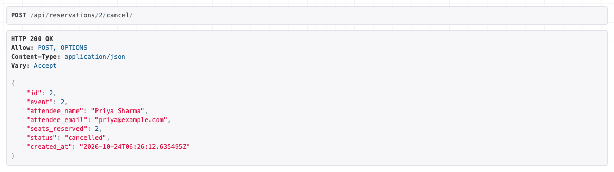

### Seats restored to the event

PyCon India 2025 is back to 500 available seats, and confirmed `reservations_count` is 0.

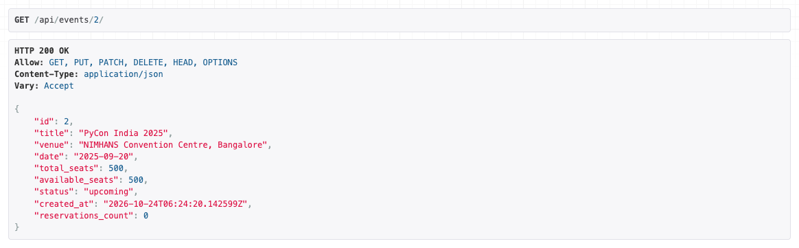

### List reservations

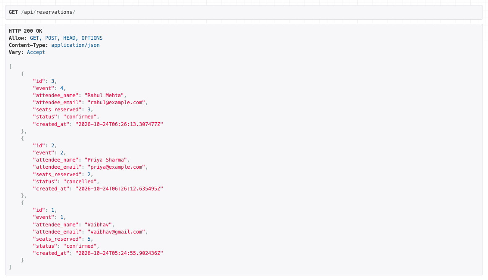

### Filter reservations by event_id

`GET /api/reservations/?event_id=4` returns only Rahul Mehta’s booking for Jazz Night.

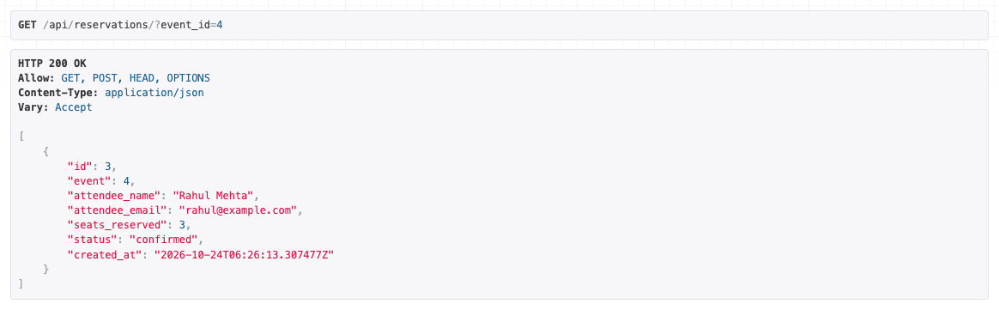

### Request logging middleware

Every API call is written to the `runserver` terminal as `METHOD path - status - duration`.

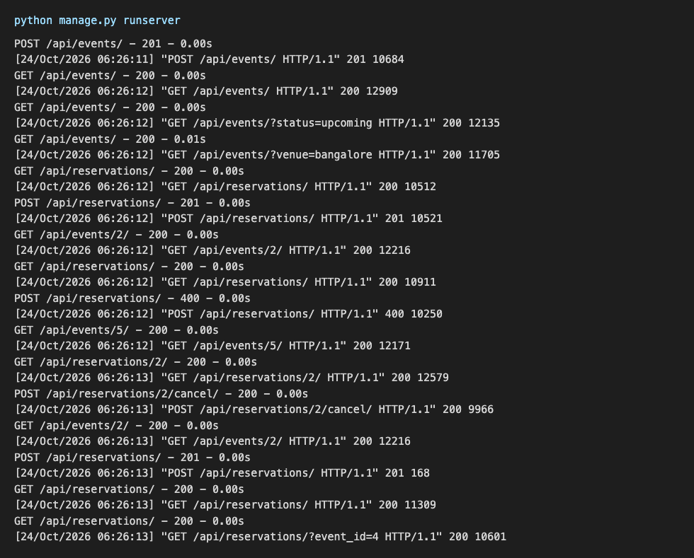

## Design decision

Seat changes lock the event row inside `transaction.atomic()` before the available count is checked again.

Checking availability in `validate()` is not enough on its own. Two requests can both read "1 seat left", both pass validation, and both create a reservation. `select_for_update()` makes the second request wait, re-read `available_seats`, and return `400` if those seats were just taken. Cancellation and deletion use the same lock so restored seats are not lost while another booking is in progress.

The deduction still happens in `ReservationSerializer.create()`, next to the reservation insert, so both writes stay in one place.
